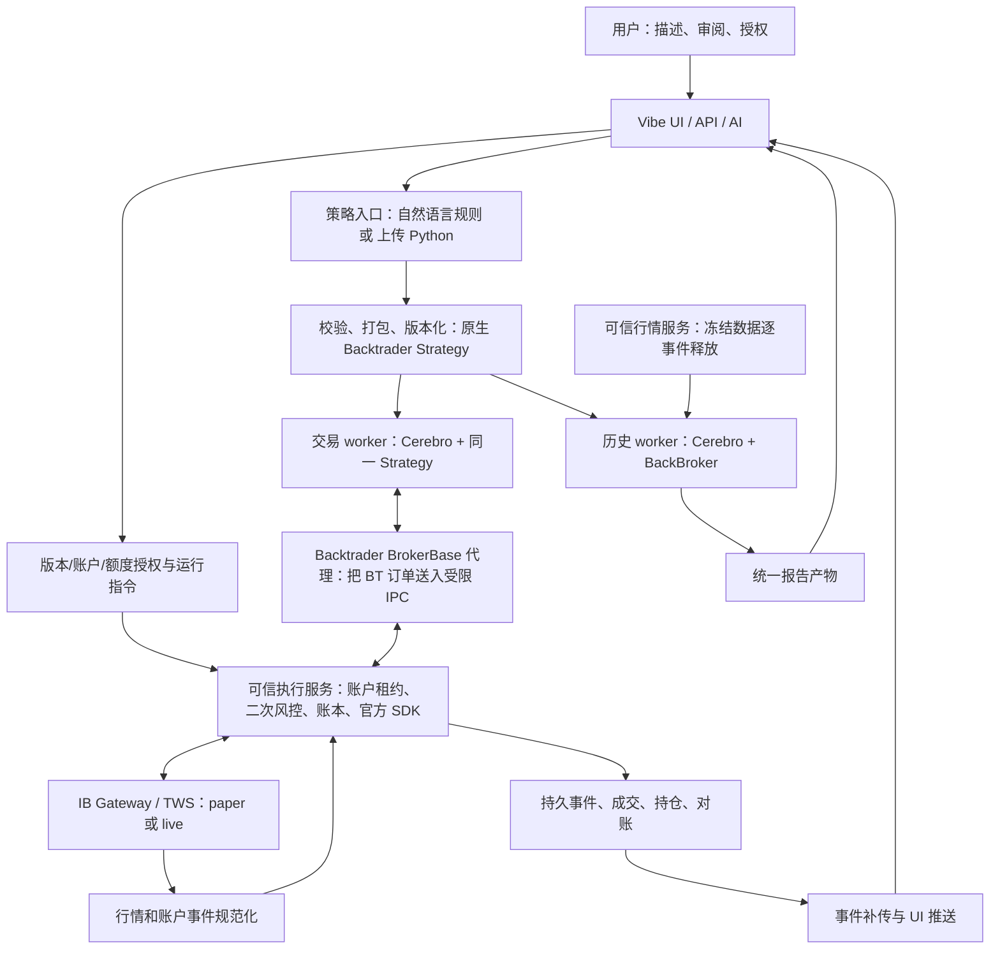

# 架构评审与产品设计

设计版本 1.2，2026-10-09。本文的“必须”是待实现验收约束，“已有”只指 EVIDENCE 中列出的源码事实。双入口设计复审见 REVIEW.md；尚未实现。

## 1. 评审结论

**在 Vibe-Trading 主应用仓库开发，以 Backtrader 作为新交易链路的统一策略运行引擎。** 用户通过 Vibe 描述、确认、回测、部署和监督策略。历史回测、券商模拟盘、未来实盘运行相同的不可变策略版本，分别使用相应的数据源与 Broker。

这是一项交易系统集成工程。核心新增量是：策略契约、现代 IBKR Broker、可靠订单账本、账户恢复、部署审批和状态界面。现有两个项目提供基础，但没有替我们完成这些连接。

### 1.1 应该在哪个仓库改

| 方案 | 主要工作 | 长期结果 | 结论 |
|---|---|---|---|
| Vibe 为应用主体，增加 Backtrader runtime | 保留对话、研究、报告、前后端；接入新的执行域 | 应用演进与引擎升级分开，用户只有一个产品入口 | **采用** |
| Backtrader 为主体，迁入 Vibe 产品能力 | 向引擎仓库搬 UI、API、AI、存储、会话与报告 | 应用代码和框架代码混杂，上游维护成本增加 | 不选 |
| 另起第三套平台，再搬两个项目 | 重做大量产品基础设施 | 初期无明确收益，迁移面最大 | 当前不选 |

建议在自己的 Vibe fork/分支中开发。`backtrader` 锁定版本/提交和安装来源。Feed、Broker、Analyzer 扩展优先放 `agent/src/bt_runtime/`，不往 `backtrader/` 核心源码里堆业务。只有公开扩展接口确实无法解决的问题，才提出单独最小补丁和复现证据。

本地两仓库均有未提交文件。新 worktree 不会自动带上这些工作；必须先记录、区分归属，再决定复用。不能 reset、stash 或覆盖用户已有修改来制造“干净环境”。

### 1.2 对原 HTML 的评价

原 HTML 的核心意图是保留 Vibe 的研究/信号/产品入口，让 Backtrader 增补事件驱动执行和 IBKR 下单。方向技术上成立；它也正确指出时间、信号、订单、报告和恢复需要适配。

但 HTML 推荐“路线 A：Vibe 回测 + Backtrader paper，后面再评估统一回测”。这适合验证桥接概念；用户现在明确要求 Backtrader 回测、模拟盘、实盘，因此本方案从第一条可部署策略开始采用 HTML 的路线 B，并让策略由统一规则生成。原 Vibe 引擎可以继续服务旧研究功能，UI 必须展示实际使用的后端；旧研究结果不会自动取得新链路的部署资格。

HTML 还没有细化可开发的 Broker 兼容方案、不可变部署版本、事件落库、重复/乱序回报、断线后不确定订单、同账户所有权和任意生成代码的隔离。这些是本方案补足的主要内容。

### 1.3 关键技术决策

| 决策 | 原因 | 代价/后续条件 |
|---|---|---|
| 真实 Backtrader Strategy + Broker 生命周期 | 满足用户指定引擎，并统一决策与订单回报接口 | 必须实现现代 IBKR Broker，不能只写 HTTP 下单代理 |
| NL2 模板 + 用户 Python 模板上传 | 都编译/封装为固定 Backtrader Strategy 版本；共享回测、订单和报告路径 | Python 上传需额外隔离/依赖限制和运行验收，门槛未过只开放离线回测 |
| 官方 `ibapi` 为首选连接实现 | 本地已有该 SDK 与行情 POC；避免把旧 IbPy 当成现成可用交易链 | 仍需兼容验证；仅锁定版本，不推定所有 TWS 版本兼容 |
| 一个账户/环境只运行一个主动策略 | 消除首版资金争抢、净持仓归属歧义 | 多策略须新增账户级组合分配器后开放 |
| 单仓库模块化应用 + 独立 worker | 产品开发方便；交易循环独立于浏览器、聊天和 Web 请求 | 仍需进程管理、IPC、迁移、锁、恢复机制 |
| 持久化账本优先，推送从账本派生 | 页面刷新、掉线、满队列不应丢失交易事实 | 多一层持久事件和补传接口 |

## 2. 首期产品完成线

用户路径：

1. **描述策略**：“某只股票，短均线上穿长均线买入，下穿卖出。”
2. **确认规则卡**：标的/合约、周期、公式、参数、暖机长度、判断时点、资金上限、数量规则、下单时段、费用假设。AI 对未支持条件不能自行删减。
3. **运行 Backtrader 回测**：选择可用的冻结数据区间；看权益、回撤、交易、费用、未平仓持仓及数据限制。失败显示原因，不能退回旧引擎而不告知。
4. **部署 IBKR 模拟盘**：选择明确的 paper 账户；授权一个策略版本、标的、额度、有效期、停止规则。确认后自动执行，无需逐单点击。
5. **观察运行**：显示行情时间、最后决策、订单真实状态、部分成交、实际持仓、目标仓位、风险阻断、连接和对账状态。
6. **管理**：暂停新增风险、撤销本系统未完成委托、恢复、结束运行；“卖出清仓”单独说明并单独授权。
7. **未来启用 live**：沿用相同流程，但使用不同账户/环境配置、单独授权和上线验收记录；不能把 paper 页面的一次授权复用到 live。

首期默认：普通美国股票/非杠杆 ETF、USD、整股、只做多、一个合约、日线、常规交易时段。先 SMA 交叉，再 RSI；具体限额由用户填。系统能力扩展不能由 AI 的一句话自动开启。

首期支持两种策略来源：自然语言生成受控模板、用户上传符合模板的 Python Backtrader 策略。两者都可走 BT 历史回测；上传 Python 只有在执行隔离、依赖限制、风险 Broker 和策略验收全部通过后，才具备 paper 部署资格。首期不承诺任意第三方依赖/任意系统调用/复杂期权期货/做空杠杆/多策略资金共享/高频成交精度/多用户/手机专用应用。

## 3. 系统组成

### 3.1 Vibe 应用层

负责自然语言交互、策略规则编辑、版本目录、报告展示、运行控制、用户授权、查看订单与状态。复用已有组件，而不是重写一个聊天/报告产品。

AI 可以起草规则、解释报告、建议修改。授权记录、broker environment、风险上限、正在运行的版本只能通过用户明确操作变更；模型工具调用不具备暗中批准自己的权限。

这里的 `LiveRunner` 是 Vibe 内部的 agent 对话运行器：它会按既有调度/会话机制唤起 AI，让 AI 继续一轮工作、调用工具、回复会话。它服务的是“AI agent 怎么接着工作”，不是 Backtrader 那种持续消费行情、计算策略、管理订单回报的确定性交易循环。这个名字容易让人以为它就是自动交易引擎。

职责分开理解：**AI agent 是策略研究与交互助手；Backtrader worker 是固定版本策略的交易运行时。** AI 可以生成/解释规则或报告，不能在每根 bar 到来时临时替换交易逻辑，也不能借 `LiveRunner` 跳过策略版本、授权和 Broker 风控。现有 mandate/stop/reconcile 的概念和局部纯函数可复用，状态键、账户范围和持久化假设必须重新核对。

### 3.2 策略定义与编译

V1 提供两种输入，最终归档为同一种 `StrategyVersion`，由同一个 Backtrader 策略运行接口执行：

1. **自然语言模式（NL2Strategy）**：AI 把用户描述转换成 schema 化 `StrategySpec`，系统检查可支持性并展示规则卡；用户确认后，受控模板编译器生成受信任的 `bt.Strategy`。
2. **Python 上传模式**：用户下载我们提供的 `bt.Strategy` 模板，按约定填写自己的 `__init__` 指标/参数、`next` 决策和可选订单通知逻辑，上传 `.py` 与参数定义。系统校验类继承、入口、参数、依赖和 Broker API 使用，展示源代码、检查结果和版本 hash。上传代码可以使用受支持的 Backtrader 指标及订单 API，但不能直接导入 IBKR 客户端、打开 socket、访问凭据、创建子进程、读任意文件或私装依赖。

两种模式在研究区都可以用真实 `Cerebro + BackBroker` 回测。部署时执行同一 hash 对应的 BT Strategy bundle；风险、数据、资金、订单、账本和恢复流程完全共用。NL2 版本较容易审阅并标注规则；Python 版本更灵活，但系统无法仅凭描述保证其策略意图，需展示代码/差异、遵守限额，并在模拟盘验证。

这里的“模板”是统一策略接口和运行约束，Python 用户仍可编写自己的指标组合及买卖条件。NL2 默认按目标比例计算数量；Python 可明确提交整股数量，系统按其已登记数量模式处理，不能二次套用仓位公式。首期都遵守完整日线决策、下一常规会话执行、只做多及指定标的约束；不是任意 Python 脚本均可上传运行。

Python 静态检查只用来发现接口/常见错误，**不视为安全沙箱**。paper/live 运行必须在受限 worker 中执行，交易 SDK 密钥/网络只由受信任的 Broker 服务持有。策略进程只能通过有限 Broker IPC 提交受 grant 约束的 Backtrader 委托；IPC 服务对账户、版本、资产、数量、次数、订单状态再次做授权和风险校验。策略进程不得访问任意网络、凭据、宿主文件或其他账户。OS/容器隔离与负向测试未在目标平台成立之前，上传代码只允许在离线回测沙箱运行，不能部署 paper/live。

以 SMA 为例：完整 bar 到达 → 指标更新 → 与上次条件比较 → 若进入/退出状态，生成目标仓位 → 计算固定整数数量 → 原生 `buy/sell` → Backtrader Broker → 回报更新策略。NL2Strategy 模式由模板生成这些步骤；Python 上传模式在 `next()` 表达决策、在订单回调维护状态，二者经过相同 Broker 风控和订单生命周期。SMA 模板不会隐式每日再平衡；Python 的明确整股指令按其自身版本规则处理。

Python 可能保存“连续满足三次才买入”等自定义状态。每个策略必须有版本化 JSON 状态契约；订单先在本次回调内暂存，只有完整事件结果和 checkpoint 被可信执行服务原子接收后才能进入派单。重启先影子重放原始输入和当时账户/成交事件、核对状态，再对账恢复；只重新计算几根均线不能恢复任意程序。细节在 CONTRACTS 2、5 节。

研究区已有 `SignalEngine.generate(data_map)` 可保留。若未来迁移某个旧策略，必须完成等价规则表达、前视检查、订单语义定义和新引擎验收；不做“一键承诺所有旧信号都可实盘”。

### 3.3 Backtrader runtime

- 历史：`Cerebro + 同一策略类 + 冻结 Feed + BackBroker + 分析/导出器`。
- paper/live：`Cerebro + 同一策略类 + 实时/补齐 Feed + 自定义 IBBrokerAdapter(bt.BrokerBase)`。
- 隔离策略进程内的 `IBBrokerAdapter(bt.BrokerBase)` 保持 Backtrader 的 buy/sell/cancel/order lifecycle；它只把订单命令和券商事件经受限 IPC 传递。
- 可信执行服务持有官方 SDK 连接、账户独占租约、持久账本和二次风控，并通过 IPC 把规范化回报交给 Backtrader BrokerAdapter，后者更新 BT Order/Position 并通知策略。
- 策略中的 Backtrader order ref 与内部 order id、IB clientId/orderId/permId、execId 建立映射，不能把它们混成一个 ID。
- 官方 SDK 网络回调只入可信服务的回调队列；Backtrader runtime 只在自身事件线程应用 IPC 回报，避免 SDK 线程并发修改策略和 BT 对象。
- 日线没有新 bar 时，仍须处理订单回报、取消指令、连接状态和定时派单。不得只在 `Strategy.next()` 内处理这些事务。

官方 SDK 版本变化、Gateway 登录方式、行情权限都是集成条件；选 SDK 不等于已经兼容。现有只读 Feed 可以作为原型参考，重构成共享连接、统一时区、完整 bar、限流与重连处理后再接入。

### 3.4 四种运行模式

| 模式 | 数据来源 | 成交来源 | 能说明什么 |
|---|---|---|---|
| 历史回测 `backtest` | 冻结历史快照 | Backtrader BackBroker | 策略在指定数据和撮合假设下的表现 |
| 事件回放 `replay` | 已记录行情/券商事件或明确的合成事件 | 回放事件或标明的本地模拟 Broker | 决策、状态机、恢复与幂等是否一致 |
| IBKR 模拟盘 `paper` | 合格的在线数据 | IBKR paper 回报 | 完整系统与券商模拟环境是否连通、状态是否闭环 |
| IBKR 实盘 `live` | 合格的在线数据 | IBKR live 回报 | 真实资金执行 |

给 BackBroker 接实时行情只能叫本地模拟，不能在 UI 标成“IBKR paper”。IBKR paper 也不能证明真实市场成交质量；其模拟成交有限制。[IBKR 模拟盘说明](https://www.ibkrguides.com/clientportal/aboutpapertradingaccounts.htm)

## 4. 如何获得可信的一致性

需要保持一致的是：规则版本、可见数据、决策时点、指标暖机、目标解释、数量算法和风险处理。历史、paper、live 的行情和成交环境不相同，最终收益不会因此自动相等。

### 4.1 时间与数量

所有 bar 同时保存交易日、交易所时区、开始/结束、实际可用时间、是否完整。只在完整且已可用的数据上决策。UI 中的“10 月 8 日”不能被随意解释为 UTC 午夜。必须覆盖夏令时、半日市、节假日和缺失日。

日线 V1：交易日 D 完整 bar 可用后计算信号与固定数量；历史 Market 委托由下一根有效 bar 的开盘规则模拟成交。在线运行在下一有效 RTH 开始且行情可用时派单。历史开盘价是建模近似，不是线上精确可实现的承诺。

数量用决策时已知的价格、可用额度、持仓与未完成委托计算；次日派单前再次验证风险。若跳空导致越限，拒绝/暂停并记录，而不是偷偷使用未来价格回写昨日订单数量。具体公式见 CONTRACTS。

避免双重延迟：原 Vibe 引擎已有信号 shift；新策略直接处理当时 bar，后续 BackBroker 撮合已造成下一 bar 成交，不得再套一次 shift。禁止启用 `cheat_on_close` 或 `cheat_on_open` 来美化结果。

上传代码还需要数据可见性边界：认证回测采用逐事件 Feed，关闭 preload/runonce，完整历史文件和含未来数据的 DataFrame 留在可信数据服务。无网络权限本身不会阻止同进程读取预加载的未来数据；必须同时限制输入释放。这能降低无意前视风险，不能证明源码没有人为硬编码未来结果。

### 4.2 数据与公司行动

回测输入必须有可复现 manifest：来源、请求参数、字段/单位、日历版本、时区、复权方式、下载时间、内容 hash、缺口/修订、暖机段与统计段。数据获取和策略执行分开，worker 不能悄悄联网替换样本。

拆股/分红会影响历史价格、数量、现金和绩效；不能拿复权价格当可成交价格混算。V1 要么实现并验证相应公司行动记账，要么对存在相关事件而未被支持的窗口拒绝认证回测，并明确返回限制。在线收到拆股、异常持仓变化或合约变化，应暂停并对账，直到语义处理完成。缺少可靠事件来源本身是明确阻塞条件，不能解释成“这段没有事件”。

报价权限不足、延迟行情、旧快照、样本修订必须可见。首期 paper 的交易派发要求满足配置的新鲜度；不能用历史尾条冒充实时报价通过检查。

### 4.3 报告

一个新的后端标识 `execution_backend=backtrader`，不要覆盖现有 `engine=daily/options` 字段。旧结果仍带实际后端标签；只有 Backtrader 验证通过的版本可部署新 runtime。

复用 Vibe 报告产物外观和消费接口，按原 schema 导出适配。但账本权威记录是 fills 与现金/持仓事件；`trades.csv`、往返交易统计和 UI 表格是派生视图。尚未卖出的真实持仓不能为了报告整齐被假装平仓。费用晚到需生成报告修订，不能悄悄改历史文件。

## 5. 自动交易、风控、停止

### 5.1 授权对象

一次授权必须绑定策略版本 hash、broker、account、paper/live、合约白名单、订单类型、整股/做多限制、单笔/总敞口、日亏损、日订单数、有效期、数据新鲜度、自动停止动作。金额不能从演示值复制为真实授权。

部署授权允许该范围内自动下单；新版本、更大额度、更多合约、环境切换均需新授权。撤销授权只阻止后续动作，不表示已发往券商的委托消失。系统应进入撤单/对账流程，并持续显示残余风险。

### 5.2 风控分两次

第一次：策略意图生成时检查规则、数量、账户和预算，持久化资金/数量预留。

第二次：真正 dispatch 前检查授权仍有效、worker 所有权、账户/行情新鲜、交易时段、预算、重复键、杀停状态。持仓加未完成买单一起计入敞口；卖出不得超过已确认可卖数量减未完成卖单。下单后仍监控成交、敞口和亏损。

风险上限是系统阻断条件，不是对损失/成交价的保证。市场跳空、在途订单和连接断开可能造成超限。日亏损明确采用已实现与未实现损益，并处理入金/出金；不能只盯已平仓交易。

### 5.3 四个不同操作

| 操作 | 确切含义 |
|---|---|
| 暂停新增风险 | 不再创建增加敞口的订单；继续回报/对账；原挂单如何处理由明确配置决定 |
| 撤销本系统委托 | 对本系统有所有权的未终结订单发取消请求，等待结果；成交与取消可能竞态 |
| 停止运行 | 禁止新决策，处理在途状态、记录最后快照；有未确认委托时显示“停止待对账” |
| 清仓 | 生成减少实际持仓的新订单；需要单独预授权/用户确认，不等于按下 stop 就执行 |

V1 风险熔断默认建议：停止新增风险 + 尝试撤销本系统挂单 + 持续对账/告警，保留现有持仓。是否自动清仓由用户明示授权。禁止使用账户全局撤单来替代本系统委托管理。

## 6. 账本、恢复与所有权

以券商确认的成交、实际持仓和余额为账户事实，以本地账本保留完整历史与意图。目标仓位不是实际仓位；预测持仓必须标记为待确认。

可信 execution_service 对一个 broker/account/environment 拥有唯一运行租约及单机进程锁，独占账本写入和 SDK 连接。strategy_worker 只运行 BT 策略和 BrokerBase 代理，不能读写该账本；它通过有限策略通道提交当前事件结果。用户授权通过另一管理通道进入执行服务。所有意图、风险预留、发送尝试、券商回报和事件有持久记录。浏览器关闭不影响这些后台进程；第二个服务不得靠“新 clientId”逃过账户独占约束。

数据库事务与券商下单无法组成同一个原子事务。发送前先落账；发送后崩溃会留下“不知道券商是否收到”的状态。恢复时按映射查询 open orders、executions、positions，匹配订单后收敛；证据不足就暂停人工处理。绝不把超时视为未发送并重新创建订单。

恢复流程：取得租约 → 检查版本和数据库 → 连接校验账户 → 拉取完整快照与必要成交窗口 → 处理未知委托/仓位 → 补历史并只暖机不下单 → 恢复决策游标 → 开启未来决策。过期昨日信号默认不补交易，必须按明确策略规则处理。

其中状态恢复还须按前述完整事件重放与 checkpoint 验证，不得把“完成指标暖机”直接当成“Python 运行状态已恢复”。策略超时或崩溃时，可信服务依然能撤本系统挂单、接收成交、对账和推送；风控与停止不能依赖出故障的用户代码继续执行。

人工交易/其他系统交易会破坏单策略持仓归属。V1 建议使用独立 paper 账户/独立测试标的；检测到外部变动即暂停并提示，不把所有账户股票自动纳入策略，也不自动卖掉外部持仓。

## 7. 运行与通知

交易 worker 独立运行；Web 进程负责展示和提交命令。数据、授权、控制命令通过受限 IPC/本机 API 传递，不暴露任意 shell/文件执行接口。生产将 Gateway 和 worker 放在持续在线的主机上；笔记本睡眠会中断服务，应由心跳和恢复状态体现。

交易事件先在同一事务写账本/outbox，再推送 UI。UI 使用事件游标补传，重连后先补齐再展示“已同步”。已有会话 EventBus 可以镜像摘要，不能取代持久日志。默认必须有站内状态与告警；外部推送渠道由用户选择，接口先预留，不擅自替用户向任何人发消息。

建议验收目标：在可控本地事件负载下，从 worker 持久化事件到已连接 UI 展示的 p95 ≤2 秒；这不包含券商/互联网自身延迟。所有数字显示 `as_of` 和连接状态，连接断开后不能继续显示“实时正常”。主机离线时不能保证自身发出告警；如需要该保证须增加独立外部监控。

Web/control plane 长时间失联时，worker 在配置的租约/心跳期限后停止新增风险，继续尽力处理本系统撤单与对账。禁止由自动重启在未知订单/错误环境下直接恢复交易。

## 8. 安全边界与部署

交易 worker 允许两类固定版本：受信任模板产物和通过验收的用户 Python bundle。AI 自由生成但未确认版本的 Python、旧研究 runner、AI shell 工具不能访问具有写权限的 Gateway、交易 IPC 或授权存储。仅“不传密码”“开子进程”或 AST 检查不能保证这件事：本机 TCP socket 仍可能被同权限进程访问。

因此，用户 Python 进入 paper/live 前，需用独立 OS 用户/容器或独立主机及网络策略隔离，并完成负向测试：不能连到 Gateway、不能读取秘密、不能绕过授权向 Broker 任意指定账户/品种下单、不能无限消耗资源。IPC 只提供受限交易意图入口，Broker 对每个意图做二次授权与风控。某平台无法可靠阻断时，上传代码只做离线研究，不开放自动交易；不能只换工作目录后声称隔离。历史回测本身也要限制资源，但不需要账户写通道。

安装应记录 Python、Backtrader、SDK、Gateway/TWS、protobuf、日历库、schema、编译器版本。数据库迁移先备份并支持回滚读取；部署更新默认暂停新交易、完成对账、再启动新进程。未完成订单存在时禁止直接删 runtime 数据库或替换到不兼容 schema。

Vibe LICENSE 是 MIT，Backtrader 是 GPL v3 或以后版本。对外分发整套产品前应按实际组合和分发方式审阅许可义务；独立进程不自动消除许可问题。这里是需要保留的产品决策项，不作确定法律结论。

## 9. 如何扩展

| 后续能力 | 本期应留的边界 | 真正接入时仍需补的工作 |
|---|---|---|
| IBKR 其他国家股票 | Instrument、交易日历、货币、会话、权限 capability | 外汇估值、当地规则/费用、数据、结算和验收 |
| IBKR 期货/期权 | 合约乘数、到期日、行权价、资产类型 | 保证金、展期、行权/指派、不同定价和风险；不能只换 symbol |
| A 股 + QMT | BrokerAdapter / MarketDataProvider / MarketRules | 交易单位、涨跌停、T+1、接口部署；可能需 Windows bridge |
| 加密货币 | venue、全天日历、数量/价格精度、手续费资产 | 交易所鉴权、限流、资金费、清算规则、连接与成交验收 |
| 多策略同账户 | strategy_id / allocation_id / account_id 分离 | 账户级组合分配、订单合并和净额持仓归因，替换首期独占锁策略 |
| 多用户 | 资源 ID 与账户授权关系显式 | 身份/租户隔离、权限、密钥托管、限流与审计，届时专项设计 |

IBKR 确实覆盖多种市场和产品，但具体账户/API 使用取决于相应权限；本系统应按“能取数据 / 能回测 / 能 paper / 能 live”分别声明能力，不能用一个 `supported=true` 承诺全部。[IBKR 账户交易权限说明](https://www.interactivebrokers.com/docs/web-api/account-management/schema/accounts)

扩展顺序建议：稳定 SMA paper 闭环 → RSI/更多模板 → live 准入 → 同市场多标的组合 → 再选一个新市场。每步复用账本与运行控制，增加新的市场规则和适配验收。
