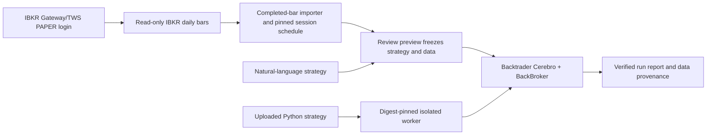

# Integrated Backtrader + IBKR usage

## Data and execution flow



IBKR is the market-data source in this workflow. The downloaded historical snapshot is reviewed and frozen before confirmation; confirmation consumes the same snapshot instead of fetching different bars. Python code runs in the isolated worker and emits bounded event proposals; Backtrader's `BackBroker` performs the offline backtest.

## One-time local setup

1. Start IB Gateway or TWS and log in to a PAPER environment. Keep IBKR API Read-Only enabled. Standard local PAPER ports are Gateway `4002` and TWS `7497`; the UI lets you select the endpoint.
2. Start the local application from the repository:

   ```sh
   bash scripts/dev up
   ```

   The frontend is normally at `http://127.0.0.1:5899`; the backend is at `http://127.0.0.1:8899`.

3. For Python uploads, build the trusted worker image in the Docker context used by the backend. The checked-in Dockerfile pins its Python base image digest:

   ```sh
   docker --context colima-vibe-execution build \
     --network=none --pull=false \
     --file agent/src/execution/strategy_worker_image/Dockerfile \
     --tag vibe-strategy-worker:local \
     agent/src/execution/strategy_worker_image

   docker --context colima-vibe-execution image inspect --format '{{.Id}}' vibe-strategy-worker:local
   ```

   Put the inspected immutable image ID in the user-level `~/.vibe-trading/.env` and set the context:

   ```dotenv
   DOCKER_CONTEXT=colima-vibe-execution
   VIBE_PYTHON_WORKER_IMAGE=sha256:<inspected-image-id>
   ```

   Restart the backend after changing this file:

   ```sh
   bash scripts/dev restart backend
   ```

   The current machine has this configured already. The image must exist in the selected Docker daemon; the application does not pull or build worker images at runtime.

## NL2 backtest

1. Open the **Execution** page and select the natural-language strategy entry.
2. Describe a supported strategy and choose the instrument, date window, and local IBKR PAPER profile. Select Gateway PAPER `4002` or TWS PAPER `7497` as appropriate.
3. Request a preview. Review the parsed strategy, date range, IBKR data provenance, bar count, calendar, and the frozen snapshot details.
4. Confirm the preview to run Backtrader. Inspect the final metrics, order/fill trace, data snapshot, and report-integrity status.

The preview and confirmation use the same frozen historical bars. A missing or incomplete daily session causes the importer to reject the preview.

## Python upload backtest

1. Prepare a Python strategy with the supported `on_event(event, state)` interface. Start from `frontend/public/templates/vibe_strategy_template.py`; the worker receives one completed bar per event and a JSON checkpoint.
2. On the **Execution** page, select Python upload, upload the `.py` file, choose an instrument and date window, then select IBKR PAPER and the local port.
3. Request an IBKR market-data preview. Review the generated CSV, pinned XNYS session schedule, strategy/source identity, worker image digest, and runability status.
4. Confirm the same preview to run the isolated worker and Backtrader. Inspect the report and integrity result.

If the preview says the worker image is unavailable, check the backend's `VIBE_PYTHON_WORKER_IMAGE` and `DOCKER_CONTEXT`, verify the image exists in that context, then restart the backend. A mutable tag such as `:latest` is not accepted as the worker identity.

## Scope and operating boundary

- This workflow performs historical-data backtests with Backtrader. It does not submit an IBKR order.
- An IBKR handshake and historical data access do not verify the selected account's positions or balances. Use the read-only connection check for connection evidence; account identity and position checks are separate acceptance items.
- Current verified data is AAPL daily history. Streaming AAPL may require an additional IBKR market-data subscription; the prior `10089` response remains unresolved.
- Real order execution, including PAPER order acknowledgement, fill callbacks, cancellation, restart recovery, and reconciliation, requires a separate reviewed workflow. Live trading remains deferred.
